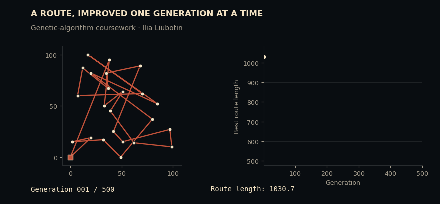

# Genetic algorithms — experimenting with the search

I spent a lot of time on these assignments: first studying how the operators work, then putting them together and tuning the early experiments. This was one of the parts of my AI coursework that I enjoyed most.

The repository contains three Python assignments from my Applied Informatics studies at **FEI STU in Bratislava**: numerical optimisation, route search and optimisation with constraints.

## Watch a route improve



This animation comes from [Cv_3.py](Cv_3.py). The search keeps two elite individuals, selects parents by tournament, combines permutations and applies mutation before evaluating the next generation.

The displayed run uses a population of **100** for **500 generations**. Its best route length decreases from **1030.7 to 508.6**. These are Euclidean distances in the assignment's coordinate system. This is one demonstration run, not a claim of finding the optimal route.

[View the final frame](assets/route-search-final.png) · [Demonstration metadata](assets/demo-metadata.json)

## Explore the assignments

| File | Experiment |
| --- | --- |
| [Cv_2.py](Cv_2.py) | Numerical optimisation with selection, intermediate crossover, global mutation and local mutation. |
| [Cv_3.py](Cv_3.py) | Search for a short route through a fixed set of points, using permutation crossover and several mutation operators. |
| [Cv_4.py](Cv_4.py) | Optimisation with constraints, comparing different penalty approaches. |

I retained the original filenames and comments so these remain recognisable as coursework. The scripts contain the parameter settings and experiments as they were saved.

## Run an experiment

```bash
python3 -m venv .venv
source .venv/bin/activate
python -m pip install -r requirements.txt
python Cv_3.py
```

On Windows, activate the environment with `.venv\Scripts\Activate.ps1` in PowerShell. Run from the repository directory so the helper modules can be imported. The scripts open Matplotlib windows; close each window to continue.

To reproduce the illustration:

```bash
python -m pip install Pillow
python tools/render_route_demo.py
```

The renderer seeds Python's and NumPy's random generators with `42`, runs the original route script and illustrates its tenth run. It checks the validity and recorded length of the routes shown over all 500 generations. The original scripts use randomness, so ordinary runs may produce different results.

## Source and learning context

My work here is the assignment-specific algorithms, experiments and tuning. [genetic_all.py](genetic_all.py) is the course helper library I studied and used; [invord.py](invord.py) supplies the inversion operation used by the route exercise. The helpers are retained alongside the assignments rather than presented as a new general-purpose library.

The original five source files were copied without changes. Portfolio additions are this documentation, dependency list and the demonstration renderer. The route example was executed for the illustration; the other assignments are included as saved coursework and were not rerun in this presentation pass.

[My profile](https://github.com/ZakaGreen) · [Earlier ML exercises](https://github.com/ZakaGreen/AI_studying)
