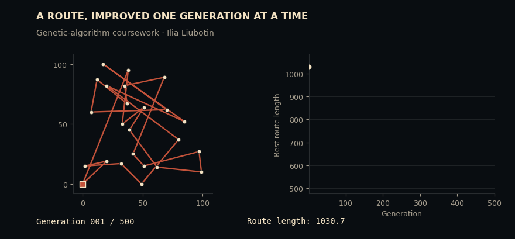

[English](README.md) · [Slovenčina](README.sk.md) · [Русский](README.ru.md)

# Генетические алгоритмы — эксперименты с поиском решений

Этим заданиям я уделил много времени: сначала изучал работу операторов, затем собирал из них алгоритмы и настраивал первые эксперименты. Это была одна из самых интересных для меня частей курса по искусственному интеллекту.

В репозитории три задания на Python из программы прикладной информатики **FEI STU в Братиславе**: численная оптимизация, поиск маршрута и оптимизация с ограничениями.

## Как маршрут становится лучше



Анимация получена из [Cv_3.py](Cv_3.py). Алгоритм сохраняет двух элитных особей, выбирает родителей турниром, скрещивает перестановки и применяет мутации перед оценкой следующего поколения.

В показанном запуске **100 особей** и **500 поколений**. Длина лучшего маршрута уменьшается с **1030,7 до 508,6**. Это евклидовы расстояния в системе координат задания. Показан один демонстрационный запуск, без утверждения, что найден оптимальный маршрут.

[Последний кадр](assets/route-search-final.png) · [Метаданные демонстрации](assets/demo-metadata.json)

## Обзор заданий

| Файл | Эксперимент |
| --- | --- |
| [Cv_2.py](Cv_2.py) | Численная оптимизация с отбором, промежуточным скрещиванием, глобальной и локальной мутациями. |
| [Cv_3.py](Cv_3.py) | Поиск короткого маршрута через фиксированный набор точек со скрещиванием перестановок и несколькими операторами мутации. |
| [Cv_4.py](Cv_4.py) | Оптимизация с ограничениями и сравнение разных подходов к штрафам. |

Исходные имена файлов и комментарии сохранены, чтобы задания оставались узнаваемыми в учебном контексте. Скрипты содержат настройки параметров и эксперименты в том виде, в котором они были сохранены.

## Запуск эксперимента

```bash
python3 -m venv .venv
source .venv/bin/activate
python -m pip install -r requirements.txt
python Cv_3.py
```

В Windows активируйте окружение командой `.venv\Scripts\Activate.ps1` в PowerShell. Запускайте из каталога репозитория, чтобы импортировались вспомогательные модули. Скрипты открывают окна Matplotlib; закрывайте каждое окно для продолжения.

Воспроизведение иллюстрации:

```bash
python -m pip install Pillow
python tools/render_route_demo.py
```

Генератор иллюстрации устанавливает seed генераторов случайных чисел Python и NumPy равным `42`, запускает исходный скрипт поиска маршрута и показывает его десятый запуск. Он проверяет корректность и записанную длину маршрутов во всех 500 поколениях. Исходные скрипты используют случайность, поэтому обычные запуски могут давать другие результаты.

## Происхождение кода и учебный контекст

Моя работа здесь — алгоритмы для конкретных заданий, эксперименты и настройка параметров. [genetic_all.py](genetic_all.py) — учебная вспомогательная библиотека, которую я изучал и использовал; [invord.py](invord.py) предоставляет операцию инверсии для задания с маршрутом. Эти модули сохранены рядом с заданиями и не представлены как новая универсальная библиотека.

Пять исходных файлов скопированы без изменений. Для портфолио добавлены документация, список зависимостей и генератор демонстрации. Пример с маршрутом был выполнен для создания иллюстрации; остальные задания сохранены в исходном состоянии и при оформлении портфолио повторно не запускались.

[Мой профиль](https://github.com/ZakaGreen) · [Ранние упражнения по ML](https://github.com/ZakaGreen/AI_studying)
