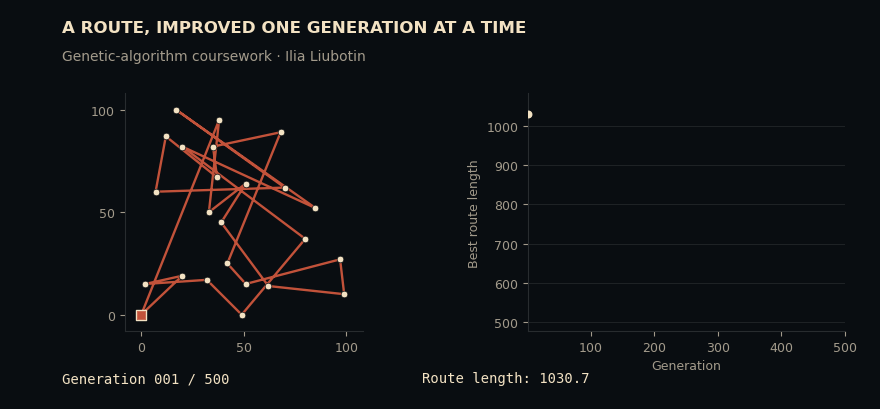

[English](README.md) · [Slovenčina](README.sk.md) · [Русский](README.ru.md)

# Genetické algoritmy — experimenty s hľadaním riešení

Týmto zadaniam som venoval veľa času: najprv som študoval fungovanie operátorov, potom ich skladal do algoritmov a ladil prvé experimenty. Bola to jedna z častí predmetu umelej inteligencie, ktorá ma bavila najviac.

Repozitár obsahuje tri zadania v Pythone zo štúdia aplikovanej informatiky na **FEI STU v Bratislave**: numerickú optimalizáciu, hľadanie trasy a optimalizáciu s obmedzeniami.

## Ako sa trasa postupne zlepšuje



Animácia pochádza zo skriptu [Cv_3.py](Cv_3.py). Algoritmus zachováva dvoch elitných jedincov, vyberá rodičov turnajom, kríži permutácie a používa mutácie pred vyhodnotením ďalšej generácie.

Zobrazený beh používa populáciu **100 jedincov** a **500 generácií**. Dĺžka najlepšej trasy klesá z **1030,7 na 508,6**. Ide o euklidovské vzdialenosti v súradnicovej sústave zadania. Je to jeden ukážkový beh, nie tvrdenie o nájdení optimálnej trasy.

[Posledná snímka](assets/route-search-final.png) · [Metadáta ukážky](assets/demo-metadata.json)

## Prehľad zadaní

| Súbor | Experiment |
| --- | --- |
| [Cv_2.py](Cv_2.py) | Numerická optimalizácia s výberom, intermediálnym krížením, globálnou a lokálnou mutáciou. |
| [Cv_3.py](Cv_3.py) | Hľadanie krátkej trasy cez pevnú množinu bodov pomocou kríženia permutácií a viacerých mutačných operátorov. |
| [Cv_4.py](Cv_4.py) | Optimalizácia s obmedzeniami a porovnanie rôznych spôsobov penalizácie. |

Pôvodné názvy súborov a komentáre som zachoval, aby zostal zrejmý ich školský kontext. Skripty obsahujú nastavenia parametrov a experimenty v podobe, v akej boli uložené.

## Spustenie experimentu

```bash
python3 -m venv .venv
source .venv/bin/activate
python -m pip install -r requirements.txt
python Cv_3.py
```

Vo Windows aktivujte prostredie príkazom `.venv\Scripts\Activate.ps1` v PowerShelli. Spúšťajte z adresára repozitára, aby bolo možné importovať pomocné moduly. Skripty otvárajú okná Matplotlib; na pokračovanie každé okno zatvorte.

Reprodukcia ilustrácie:

```bash
python -m pip install Pillow
python tools/render_route_demo.py
```

Generátor ilustrácie nastaví seed generátorov náhodných čísel Pythonu a NumPy na `42`, spustí pôvodný skript a zobrazí jeho desiaty beh. Overuje platnosť a zaznamenanú dĺžku trás vo všetkých 500 generáciách. Pôvodné skripty využívajú náhodnosť, takže bežné spustenia môžu priniesť iné výsledky.

## Pôvod kódu a kontext učenia

Mojou prácou sú algoritmy pre konkrétne zadania, experimenty a ladenie parametrov. [genetic_all.py](genetic_all.py) je pomocná knižnica z predmetu, ktorú som študoval a používal; [invord.py](invord.py) poskytuje operáciu inverzie pre úlohu s trasou. Pomocné moduly sú zachované pri zadaniach a nie sú prezentované ako nová univerzálna knižnica.

Pôvodných päť zdrojových súborov bolo skopírovaných bez zmien. Pre portfólio pribudla táto dokumentácia, zoznam závislostí a generátor ukážky. Príklad s trasou bol spustený na vytvorenie ilustrácie; ostatné zadania sú uložené v pôvodnom stave a pri príprave portfólia neboli znova spustené.

[Môj profil](https://github.com/ZakaGreen) · [Skoršie cvičenia ML](https://github.com/ZakaGreen/AI_studying)
